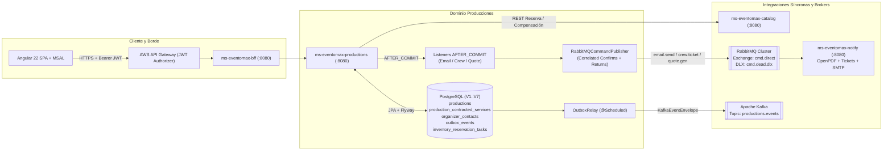

# ms-eventomax-productions — Microservicio de Dominio de Producciones y Orquestación Asíncrona (EP2)

**Asignatura:** Desarrollo Cloud Native I (`DSY1107`)
**Caso de Estudio:** Caso 8 — Plataforma de Producción y Montaje de Eventos (**EventoMax**)
**Equipo:** Ignacio Valeria, Benjamín Flores, Benjamín Espinoza

---

## 1. Propósito del Repositorio y Rol en EventoMax

`ms-eventomax-productions` es el microservicio central de escritura transaccional (*System of Record*) para el ciclo de vida de producciones de eventos, contratación de servicios de catálogo, coordinación de reservas de equipamiento e información de contacto minimizada del organizador.

En la arquitectura híbrida de **EventoMax EP2**, cumple un doble rol de mensajería desacoplada:
1. **Productor de Comandos Operativos hacia RabbitMQ (`cmd.direct`):** Dispara comandos punto-a-punto post-commit (`TransactionPhase.AFTER_COMMIT`) con **Publisher Confirms correlacionados** (`publisher-confirm-type: correlated`, `mandatory: true`) para:
   - Notificación por correo de cambios de estado (`email.send` → `q.cmd.email`).
   - Asignación de tickets de cuadrilla técnica al pasar a ejecución (`crew.ticket` → `q.cmd.crew`).
   - Generación del **Acta y Cotización Formal de Cierre en PDF** al cerrar la producción (`quote.gen` → `q.cmd.quote`), adjuntando un contrato enriquecido de 16 campos con servicios contratados, contacto del organizador enmascarado y línea de tiempo transaccional verificable.
2. **Productor de Eventos de Dominio hacia Apache Kafka (`productions.events`):** Implementa el patrón **Transactional Outbox** sobre PostgreSQL (`outbox_events` + `OutboxRelay`) para alimentar de manera asíncrona las proyecciones CQRS de `ms-eventomax-report` y la trazabilidad inmutable de `ms-eventomax-audit`. En despliegues AWS EC2 donde Kafka se mantiene apagado (`KAFKA_OUTBOX_RELAY_ENABLED=false`), todos los eventos de negocio (`ProductionCreated`, `ProductionStatusChanged`) se persisten íntegramente en `outbox_events` con estado `PENDING` (`retries=0`), sin perder ningún evento y permitiendo que el flujo completo de producción, comandos RabbitMQ y generación de Acta PDF opere al 100%.

---

## 2. Arquitectura del Módulo y Diagrama



---

## 3. Endpoints Expuestos

| Método | Ruta | Roles Autorizados (JWT + Scope `access_as_user`) | Descripción |
|---|---|---|---|
| `GET` | `/api/productions` | `Admin`, `Productor`, `Organizador` | Lista producciones (filtradas automáticamente por `organizerId` para `Organizador`). |
| `GET` | `/api/productions/{id}` | `Admin`, `Productor`, `Organizador` | Obtiene detalle de una producción (valida anti-IDOR para `Organizador`). |
| `GET` | `/api/productions/{id}/services` | `Admin`, `Productor`, `Organizador` | Lista los servicios de catálogo contratados en la producción (valida anti-IDOR para `Organizador`). |
| `POST` | `/api/productions` | `Productor`, `Organizador` | Crea una nueva producción en estado `SOLICITADO` y registra evento `ProductionCreated` en Outbox. |
| `PUT` | `/api/productions/{id}/status` | `Admin`, `Productor` | Ejecuta transición en máquina de estados (`SOLICITADO → CONFIRMADO → EN_EJECUCION → CERRADO` o `CANCELADO`), coordina reservas y servicios de catálogo y dispara comandos RabbitMQ + eventos Outbox. |
| `POST` | `/api/productions/{id}/quote-command/republish` | `Admin`, `Productor` | Reconstruye desde PostgreSQL y republica de forma segura e idempotente el comando `quote.gen` para una producción en estado `CERRADO`. |
| `GET` | `/api/organizers/{organizerId}/contact` | `Admin`, `Productor`, `Organizador` | Obtiene el contacto registrado del organizador (valida anti-IDOR para `Organizador`). |
| `PUT` | `/api/organizers/{organizerId}/contact` | `Admin`, `Organizador` | Registra o actualiza correo, nombre y teléfono del organizador con trazabilidad de `user_oid`. |
| `GET` | `/actuator/health`, `/actuator/info` | Público (Healthcheck interno) | Estado de salud del microservicio. |

---

## 4. Base de Datos y Migraciones Flyway (`V1..V7`)

| Versión | Archivo | Descripción |
|---|---|---|
| `V1` | `V1__init_productions.sql` | Crea tablas `productions` y `outbox_events`. |
| `V2` | `V2__align_production_status_constraint.sql` | Alinea constraint de estados (`SOLICITADO`, `CONFIRMADO`, `EN_EJECUCION`, `CERRADO`, `CANCELADO`). |
| `V3` | `V3__create_inventory_reservation_tasks.sql` | Crea tabla de tareas de compensación/verificación de inventario. |
| `V4` | `V4__add_services_json_to_reservation_tasks.sql` | Añade columna `services_json` a las tareas de reserva. |
| `V5` | `V5__add_reservation_generation_to_tasks.sql` | Añade columna `reservation_generation` (fencing token). |
| `V6` | `V6__create_production_services_table.sql` | Crea tabla `production_services` para contratación de servicios. |
| `V7` | `V7__create_organizer_contacts_table.sql` | Crea tabla `organizer_contacts` con índice sobre `user_oid` y restricción única parcial de contacto activo por organizador. |

---

## 5. Ejecución de Pruebas Automatizadas y Despliegue Docker

```bash
./mvnw clean verify -B
docker compose --env-file .env.prod -f docker-compose.prod.yml up -d --build
```

**Resultado certificado en EP2:** `Tests run: 220, Failures: 0, Errors: 0, Skipped: 1 — BUILD SUCCESS`. Presupuesto de memoria: `mem_limit: 640m`.
