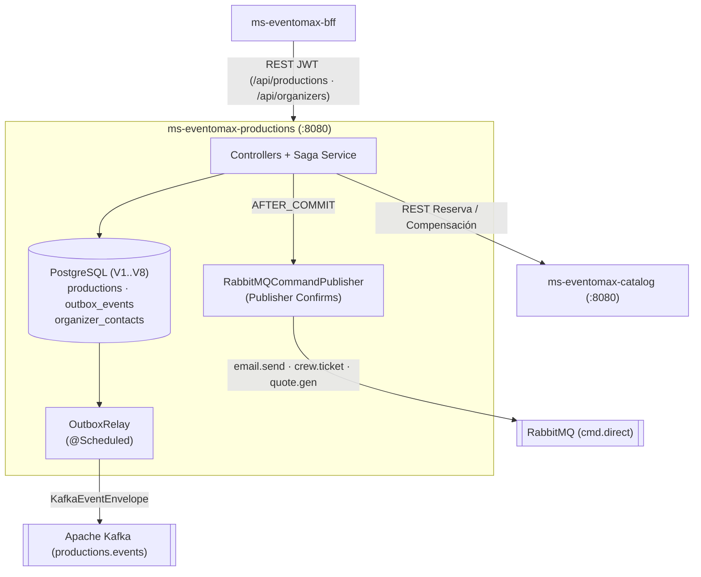

<a href="https://eventomax-production-portal-app.s3.us-east-1.amazonaws.com/index.html">
  
</a>

> **Caso de Estudio 8:** Plataforma B2B de Producción y Montaje de Eventos &nbsp;|&nbsp; **Asignatura:** Desarrollo Cloud Native (`DSY1107`) &nbsp;|&nbsp; **Equipo:** Ignacio Valeria, Benjamín Flores, Benjamín Espinoza

## Propósito del Repositorio

`ms-eventomax-productions` es el núcleo transaccional (*System of Record*) para la gestión del ciclo de vida de cada producción en **EventoMax**:

- **Máquina de Estados y Orquestación Saga:** Controla las transiciones `SOLICITADO → CONFIRMADO → EN_MONTAJE → EN_EJECUCION → CERRADO` (y `CANCELADO`), coordinando de forma síncrona las reservas de equipamiento y compensaciones con *generation fencing* hacia `ms-eventomax-catalog`.
- **Comandos Asíncronos hacia RabbitMQ (`AFTER_COMMIT`):** Emite comandos punto a punto tras confirmar la transacción en PostgreSQL con **Publisher Confirms correlacionados** (`publisher-confirm-type: correlated`, `mandatory: true`) sobre el exchange `cmd.direct`:
  - `email.send` → Notificaciones de cambio de estado (con fallback configurable vía `EVENTOMAX_DEFAULT_RECIPIENT_EMAIL`).
  - `crew.ticket` → Emisión de tickets de cuadrilla técnica al avanzar a montaje/ejecución (`V8` `crew_id`, `crew_name`).
  - `quote.gen` → Generación y republicación idempotente del Acta de Cierre PDF al estado `CERRADO`.
- **Transactional Outbox hacia Apache Kafka:** Persiste eventos de dominio (`ProductionCreated`, `ProductionStatusChanged`) en `outbox_events` dentro de la misma transacción de negocio y los publica hacia el tópico `productions.events` mediante `OutboxRelay` cuando `KAFKA_OUTBOX_RELAY_ENABLED=true`.

## Accesos Relacionados (Demo AWS)

| Recurso | Enlace HTTPS | Acceso |
| :--- | :--- | :--- |
| **Portal Web EventoMax** | [Abrir Portal Web](https://eventomax-production-portal-app.s3.us-east-1.amazonaws.com/index.html) | Microsoft Entra ID (OAuth 2.0 PKCE) |
| **Swagger UI (Tag `Producciones` / `Organizadores`)** | [Abrir Swagger UI](https://7dewsdyt7i.execute-api.us-east-1.amazonaws.com/swagger-ui/index.html) | Lectura pública · `Bearer <JWT>` |

## Endpoints Expuestos (`expose 8080`)

| Método | Ruta | Roles Autorizados | Descripción |
| :--- | :--- | :--- | :--- |
| `POST` | `/api/productions` | `Productor`, `Organizador` | Crea producción en estado `SOLICITADO` y registra evento `ProductionCreated` en Outbox |
| `GET` | `/api/productions` | `Admin`, `Productor`, `Organizador` | Lista producciones (filtradas por propiedad cuando el rol es `Organizador`) |
| `GET` | `/api/productions/{id}` | `Admin`, `Productor`, `Organizador` | Obtiene el detalle de la producción validando control anti-IDOR |
| `GET` | `/api/productions/{id}/services` | `Admin`, `Productor`, `Organizador` | Lista los servicios técnicos contratados en la producción |
| `PUT` | `/api/productions/{id}/status` | `Admin`, `Productor` | Ejecuta transición de estado, reservas/compensación Saga y dispara RabbitMQ + Outbox |
| `POST` | `/api/productions/{id}/quote-command/republish` | `Admin`, `Productor` | Reconstruye y republica el comando `quote.gen` en producciones `CERRADO` |
| `GET` / `PUT` | `/api/organizers/{organizerId}/contact` | `Admin`, `Productor`, `Organizador` (`PUT` sin `Productor`) | Consulta o actualiza contacto del organizador con trazabilidad `user_oid` |
| `POST` | `/api/productions/admin/outbox/{id}/retry` | `Admin` | Reintenta manualmente la publicación de un evento en `outbox_events` |
| `GET` | `/actuator/health`, `/actuator/info` | Interno | Sondeo de salud Docker / EC2 |

## Base de Datos y Migraciones Flyway (`V1..V8`)

| Versión | Script | Propósito |
| :--- | :--- | :--- |
| `V1` | `V1__create_productions_table.sql` | Tabla principal `productions` con estado inicial `SOLICITADO` |
| `V2` | `V2__create_outbox_events.sql` | Tabla `outbox_events` para patrón Transactional Outbox |
| `V3` | `V3__outbox_sequence.sql` | Columna de secuencia monótona `sequence_no` |
| `V4` | `V4__create_inventory_reservation_tasks_table.sql` | Tareas de coordinación y compensación de reservas en catálogo |
| `V5` | `V5__add_reservation_generation_to_tasks.sql` | Campo `reservation_generation` para fencing |
| `V6` | `V6__create_production_services_table.sql` | Servicios contratados por producción (`production_services`) |
| `V7` | `V7__create_organizer_contacts_table.sql` | Tabla `organizer_contacts` con índice sobre `user_oid` |
| `V8` | `V8__add_crew_assignment_to_productions.sql` | Columnas `crew_id` y `crew_name` para asignación de cuadrilla |

## Stack Tecnológico

<table>
  <tr>
    <td align="center" width="25%">
      <br />
      <strong>Java 25 · Boot 4.1.1</strong>
    </td>
    <td align="center" width="25%">
      <br />
      <strong>PostgreSQL · Flyway</strong>
    </td>
    <td align="center" width="25%">
      <br />
      <strong>RabbitMQ Confirms</strong>
    </td>
    <td align="center" width="25%">
      <picture>
        <source media="(prefers-color-scheme: dark)" srcset="docs/assets/tech/apache-kafka-dark.svg" />
        
      </picture><br />
      <strong>Apache Kafka Outbox</strong>
    </td>
  </tr>
  <tr>
    <td align="center" width="25%">
      <br />
      <strong>Entra ID OAuth2</strong>
    </td>
    <td align="center" width="25%">
      <br />
      <strong>Amazon RDS (schema)</strong>
    </td>
    <td align="center" width="25%">
      <br />
      <strong>Docker (640m)</strong>
    </td>
    <td align="center" width="25%">
      <br />
      <strong>JUnit 5 · Testcontainers</strong>
    </td>
  </tr>
</table>

## Arquitectura del Módulo



## Variables de Entorno y Verificación

| Variable | Ejemplo | Descripción |
| :--- | :--- | :--- |
| `DB_URL` / `DB_USER` / `DB_PASSWORD` | `jdbc:postgresql://<HOST>:5432/eventomax?currentSchema=productions` | Conexión PostgreSQL y esquema Flyway |
| `CATALOG_BASE_URL` | `http://ms-eventomax-catalog:8080` | URL interna del servicio de catálogo |
| `SPRING_RABBITMQ_ADDRESSES` | `rabbitmq-1:5672,rabbitmq-2:5672` | Nodos RabbitMQ para publicación de comandos |
| `KAFKA_BOOTSTRAP_SERVERS` / `KAFKA_OUTBOX_RELAY_ENABLED` | `ec2-kafka:9092` / `true` | Brokers Kafka y activación de `OutboxRelay` |
| `EVENTOMAX_DEFAULT_RECIPIENT_EMAIL` | `<EMAIL_FALLBACK>` | Destinatario de respaldo en notificaciones y actas |
| `ENTRA_ISSUER_URI` / `ENTRA_AUDIENCE` | `https://login.microsoftonline.com/<TENANT>/v2.0` | Validación JWT Entra ID |

```bash
# Suite completa con Testcontainers (PostgreSQL y Kafka)
./mvnw -B -ntp verify

# Despliegue Docker en red eventomax-net (mem_limit: 640m)
docker compose --env-file .env.prod -f docker-compose.prod.yml up -d --build
```
